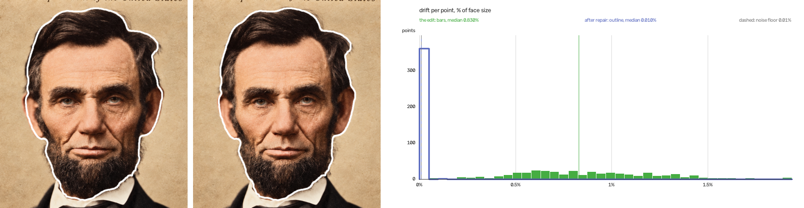
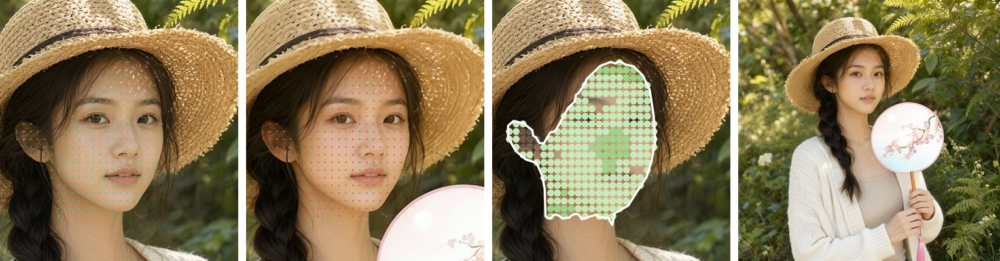

# SameFace

**ComfyUI nodes that measure where an image edit moved the parts of a face,
and move them back.** Open weights, runs locally.

SameFace follows every point of a face from the original into the edit with
optical flow (RAFT, inside a Grounded SAM 2 face mask), takes out the move,
scale and turn of the whole face, and reports what is left - the drift - in %
of face size, with plots of where it is. It then warps the edit's face back
with a thin-plate spline and measures the result again. Its noise floor,
0.01% of face size, can be re-measured with a tool in this repo.

Restore an old photo, colourise it, or ask an edit model for new hair or a
new background, and the face often comes back slightly different: an eye a
little higher, the jaw a little wider, the nose moved. You may sense that
something changed, but not where or by how much - and because we recognise
who a face belongs to so well, it still looks like the same person, so the
change is easy to let pass. SameFace says where the face moved and how far,
on one scale for every edit, and moves it back. It measures geometry - where
the parts of the face went - not likeness.



*Lincoln, 1863, colourised and restored by an edit model. White: the
original's head outline. Left, the edit lined up with the original: its head
is 3.7% wider for its height and spills over the outline, a drift of 0.83% of
its size. Middle, after SameFace's repair: back inside the outline, 0.010% -
at the noise floor, where what is left cannot be told from the measurement's
own noise.*

**Demo video**

https://github.com/user-attachments/assets/37e553e2-7d3a-49a6-8891-a112d9e83152

## What it is for

- **Old-photo restoration and colourisation.** See whether the restored face
  kept its shape, where it changed, and put it back.
- **Face edits.** New hair, background, lighting or clothes, and the same face.
- **Comparing edit models and workflows.** One figure per pair, on the same
  scale for every model, with pictures of where the drift is.
- **Character LoRA datasets.** A character LoRA learns whatever face its
  training images show. If upscaling or enhancing an image drifted the face,
  the LoRA learns a slightly different person: measure each processed image
  against its source before it goes into the dataset.

## Why optical flow, not face landmarks

SameFace comes out of a study of how to measure this at all. Aligning two
faces on a few points lines them up but cannot measure them: an affine fit
through three points leaves nothing over, for any two faces. So the study
turned to face landmark detectors - MediaPipe's 478-point mesh and FAN's 68
points - and found them too coarse for drift this small. On null pairs, a
face against a resized copy of itself, where the true drift is zero, their
points moved about as far as most edits drift:

| Null pairs: 25 faces, each resized to 512 and 1414 px | Median drift, % of face size |
|---|---|
| MediaPipe Face Mesh | 0.19% |
| FAN 2D / 3D | 0.64% / 0.56% |
| RAFT optical flow, one pass | 0.025% |
| RAFT, SameFace's two passes | 0.003% |

The edits in this README drift 0.03-0.8%. Landmarks could see the largest,
but not the small ones, and none could check a repair: the one above leaves
0.010%, a nineteenth of MediaPipe's noise. A second test, against 20,434
human-marked points on 284 faces from public landmark datasets, showed the
same from another side: the detectors' points moved under changes that move
nothing - blur, JPEG, brightness - and MediaPipe placed the outer eye corners
inside where people mark them, on three faces in four.

Optical flow has no face model to be confidently wrong, and gives several
hundred points per face. The parts are known - RAFT, a forward-backward
check, similarity and affine fits, a thin-plate spline. What SameFace adds is
putting them to this question: a dense measurement of the drift an edit
leaves in a face, a second pass that keeps the framing out of the figure, a
noise floor anyone can re-measure, and a repair that is measured again rather
than trusted. The figures, their caveats and the study are in
**[How it measures](docs/how-it-measures.md)**.

## What it does not do

- **Likeness.** Colour, skin, age or expression that leave the shape alone
  are not drift; a face can measure zero and still look older.
- **Deliberate changes.** The repair moves every measured point back,
  including any the edit moved on purpose. A feature the edit redrew - bigger
  eyes, in our tries - is not measured at all: the flow cannot follow it
  there and back, so it is left out (orange crosses in the view) and left as
  the edit made it. SameFace is for the drift nobody asked for.
- **An independent check of the repair.** The repair is graded by measuring
  it again, with the same method. Nothing independent is fine enough to
  grade it: the landmark detectors above move more on a null pair than a
  repair leaves.
- **Turned heads.** The fits are flat, so a head turned between the two
  images, or a new expression, reads as drift.
- **Groups at once.** One face per pair: for a group, measure each person
  with their own masks.

## Quick start

1. Install **SameFace** from ComfyUI Manager, or by hand (below), and
   restart ComfyUI.
2. Open `example_workflows/sameface_simple.json`, and copy the two Lincoln
   pictures from `example_workflows/input/` into `ComfyUI/input/`.
3. Run. The first Simple measures and repairs; the second measures the
   repair, for a slider of what is left. Then load your own original into
   **Before** and the edited picture into **After**.

The sliders are ComfyUI's Compare Images, which shows its slider with
**Modern Node Design (Nodes 2.0)** turned on (Settings → Comfy → Nodes 2.0);
rgthree's Image Comparer works in its place. Each example has a note saying
so.

**SameFace Simple** shows its figures on the node itself - the edit's drift,
and what the repair left - so the node alone tells you how far the face
moved. Its outputs give the two views for a slider, the repaired image, a
shift map, a histogram and the figures; they are described in
**[The nodes](docs/nodes.md)**. It measures the surest face on each side.
Turn `repair` off to only measure.



*An edit that put a fan in her hand moved the face by 0.032%; repaired,
0.013%. Left to right: `before_view`, `after_view`, `shift_map`, `repaired`.*

## The advanced nodes

Every step on its own node with all its settings, for choosing one face among
several, measuring the whole head, or drawing your own plots. All are in
**[The nodes](docs/nodes.md)**.

`example_workflows/sameface_advanced.json`, with its two pictures in
`example_workflows/input/`, is a family photo edited onto a museum backdrop:
Face Mask chooses the mother's head on each side, Measure measures it, Repair
moves it back, and a second Measure measures the repair, with a view, a shift
map and a histogram of each. Her head measured 0.211%, and 0.019% after the
repair (affine fit; a head's figures, hair included, are not comparable with
a face's).

| Node | |
|---|---|
| SameFace Measure | runs the models and gives the figures and `drift`, which the others read |
| SameFace Face Mask | one person's face or head, for Measure's mask inputs |
| SameFace Repair | moves the edit's face back, keeping its framing or lining it up with the before |
| SameFace View | the before and after with the points and a mesh, for a slider |
| SameFace Shift Map | the before with each point coloured by its drift |
| SameFace Drift Histogram | how far the points drifted, after each fit |
| SameFace Drift Zones | the face as a grid, each cell's median drift |

## How it works

1. **The face.** Grounding DINO finds it from the words "face" and "ear";
   SAM 2 outlines it.
2. **Every point of it.** RAFT optical flow follows each pixel of the before
   face into the edit and back. A point that does not return to where it
   started is left out, so texture the edit rewrote is not mistaken for
   movement. A second pass, with the two faces lined up first, keeps the
   framing out of the figures.
3. **The drift.** The move, scale and turn of the whole face are fitted and
   taken out; what is left at each point is drift, in % of face size (twice
   the RMS distance of the measured points from their centre).
4. **The repair.** A thin-plate spline through the points, eased to nothing
   beyond the face, moves each feature back. Then a fresh measurement of the
   repaired image says what is left - SameFace Simple does this itself; with
   the advanced nodes, wire a second Measure.

The **noise floor is 0.01% of face size**: twice the median drift the
measurement gives a face against a resized, recompressed copy of itself,
which has no true drift. It is re-measured by a tool in this repo, on your
own faces if you like. The method, the fits and the limits are in
**[How it measures](docs/how-it-measures.md)**.

## Open weights

No training, no API, nothing leaves the machine. The models download on first
use, about 1.8 GB, pinned to fixed revisions:

| Model | Used for | Licence |
|---|---|---|
| [Grounding DINO](https://huggingface.co/IDEA-Research/grounding-dino-base) (base) | finding the face, ears and head from words | Apache-2.0 |
| [SAM 2.1](https://huggingface.co/facebook/sam2.1-hiera-large) (Hiera large) | outlining them | Apache-2.0 |
| [RAFT](https://pytorch.org/vision/stable/models/raft.html) (large, torchvision) | the optical flow | BSD-3-Clause |

## Install

From **ComfyUI Manager**: search for SameFace and install.

By hand: clone into `ComfyUI/custom_nodes/` and install the requirements into
ComfyUI's environment:

```
cd ComfyUI/custom_nodes
git clone https://github.com/fixed-42/comfyui-sameface
pip install -r comfyui-sameface/requirements.txt
```

Restart ComfyUI; the nodes are under **SameFace**.

## Tests

Everything but the models themselves is tested without a GPU - the masks,
the sampling, the fits, the warp, the pictures, Simple and the noise floor's
rule:

```
python -m pytest
```

`tests/test_models.py` checks which detections the face masker counts, with
the models stood in for; it needs torch, so it is skipped without it. Run it
with ComfyUI's own Python to include it.

## Licence

Apache-2.0.

The pictures, in this README and in `example_workflows/input/`:

- **The originals** are in the public domain: Lincoln by Alexander Gardner,
  1863 (Library of Congress, LC-DIG-ppmsca-19301), and the family from the
  Farm Security Administration/Office of War Information collection (Library
  of Congress).
- **The edits of them, and the portrait with the fan,** were made for this
  project with image models, and are released under this repository's
  licence, Apache-2.0.
