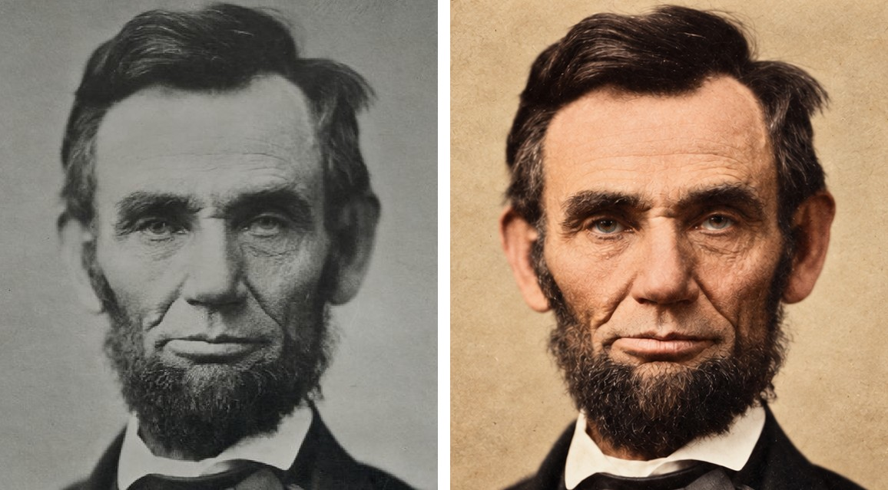

# SameFace

ComfyUI nodes that measure the geometric drift of a face between a source image
and an edited version of it, and correct it.

Dense correspondences come from RAFT optical flow inside a Grounded SAM 2 face
mask, filtered by a forward-backward check. A similarity and an affine fit remove
the global pose; the per-point residual is the drift, in % of face size. The
correction is a smoothed thin-plate-spline warp through the matched points. All
models are open weights and run locally.

## Method

1. **Mask.** Grounding DINO (prompts `face.` and `ear.`, box threshold 0.25)
   and SAM 2.1 give a face mask with the ears joined and the neck excluded. With
   `head`, SAM 2 outlines the `head.` box, hair included, and the face is joined
   in. A mask from any other node can be wired in instead.
2. **Working frame.** Each side is cropped to its own face box (mask extent +
   25 % per side) and resampled to 512 px, so resizing and reframing are not
   read as drift.
3. **Flow, pass 1.** RAFT (`raft_large`, `C_T_SKHT_V2`) forward and backward.
   Grid points every 16 working px inside the before mask are kept when the
   round trip returns within 1.5 px. RAFT gives no confidence, so this check is
   the only filter; it drops occlusions and texture the edit rewrote.
4. **Flow, pass 2.** A similarity fit through the pass-1 matches says where the
   before's crop lies in the after; the after is re-cropped there (rotated and
   scaled with it) and RAFT runs again on the aligned pair. Two box crops leave a
   residual rotation and scale that RAFT partly reads as drift. On 66 edited
   pairs the second pass lowered every figure, by 14–77 %.
5. **Fits.** Both point sets are mapped into the before image's frame. A
   least-squares similarity (Umeyama, with a reflection guard) and an affine are
   fitted. The residual at each point is its drift.
   **Face size** = 2 × the RMS distance of the before's matched points from
   their centroid. Drift is reported as a percentage of it.
6. **Repair.** The flat fit, then a thin-plate spline
   (`scipy.interpolate.RBFInterpolator`, kernel `thin_plate_spline`, degree 1)
   through the matched points, solved in units of the median point spacing with
   smoothing 1.0 and eased to zero over 2 spacings beyond the outermost points,
   so hair and background stay put. `framing = after` keeps the edit's
   composition; `framing = before` also applies the similarity fit.
7. **Re-measurement.** The warp satisfies its own points by construction, so a
   repair is judged only by measuring the repaired image again (a new RAFT run
   on new pixels).

## Figures

| Figure | Definition |
|---|---|
| median | median point drift; the headline figure |
| p90, highest | 90th percentile and maximum point drift |
| above noise | share of points above the noise floor |
| scale, turn | the fitted similarity: scale and rotation of the after onto the before |
| stretch x/y, shear | affine only: scale along the after's axes and their deviation from square |

The similarity residual includes any anisotropic stretch; the affine residual does
not. Large under similarity and small under affine means the face was mostly
stretched. Large under both means features moved relative to each other.

## Noise floor

**0.01 % of face size.** Null pairs: 25 faces, each resampled to 512 and 1414 px
and saved as JPEG (quality 92), so the true drift is zero. The two-pass median is
0.0033 %; the floor is twice that, rounded up to a 1-2-5 step (one pass: 0.0167 %,
floor 0.05 %). It applies to a face's median; single points scatter more.
`tools/calibrate_noise_floor.py <folder>` re-measures it on any set of faces.

The same null test on other correspondence methods (25 faces, 512/1414 px):

| Method | Median drift | p90 |
|---|---|---|
| MediaPipe Face Mesh (478 points) | 0.188 % | 0.565 % |
| FAN 2D (68 points) | 0.644 % | 1.162 % |
| FAN 3D (68 points) | 0.560 % | 1.140 % |
| RAFT, one pass, face box | 0.025 % | 0.060 % |
| RAFT, SameFace (mask, two passes) | 0.0033 % | |

Most edits measured so far drift 0.03–0.3 %, while the landmark detectors' own
noise is 0.19–0.64 %. Against 20,434 human-marked points on 284 faces (FAIRSET, WFLW, 300-W,
IBUG), the detectors' points also moved under changes that move nothing (blur,
JPEG, brightness): their 95th percentile was 0.5–3.0 % of the outer-eye distance
for MediaPipe and 2.7–3.5 % for FAN. Details: [How it measures](docs/how-it-measures.md).

## Accuracy against known warps

The noise floor measures repeatability, not accuracy. For accuracy, the Lincoln
portrait was warped by known amounts and put through the real models
(`tools/known_warp_check.py`, [Checking against known warps](docs/known-warp-check.md)):

| True drift (head widened) | Measure read |
|---|---|
| 0.883 % | 0.875 % (99 %) |
| 0.242 % | 0.223 % (92 %) |
| 0.073 % | 0.052 % (71 %) |
| 0.024 % | 0.010 % (42 %) |

What a repair left was computed two ways, without RAFT: by applying the repair
warp to the known point positions, and by Lucas-Kanade tracking. The results were
0.014–0.033 %. A fresh measurement read the same repairs as 0.006–0.012 %, so it
under-reads a repair by up to 5×. Quote a repair as about 0.03 %.

## Example



Lincoln, 1863, against a colourised and restored edit; head masks, hair included
(`example_workflows/sameface_demo_lincoln.json`):

    RAFT, two passes, 362 points on the face; noise floor 0.01% of face size
      similarity median 0.830%  p90 1.349%  highest 1.99%  above noise 100%
                 scale 1.0908  turn +0.51 deg
      affine     median 0.330%  p90 0.536%  highest 0.97%  above noise 100%
                 scale 1.0843  turn +0.58 deg  stretch x 1.0647 y 1.1044  shear -0.11 deg

Stretch y / x = 1.037: the edit's head is 3.7 % wider for its height. After
Repair (`framing = after`), measured again:

      similarity median 0.009%  p90 0.020%  highest 0.08%  above noise 44%
      affine     median 0.007%  p90 0.017%  highest 0.08%  above noise 33%
                 stretch x 1.0909 y 1.0912

The known-warp check puts the true remainder at about 0.03 %.
Demo video: https://github.com/user-attachments/assets/69bfca1b-3fb7-49b5-9145-54396f8a57ab

## Notes

### Geometry, not likeness

Colour, texture, age or expression that leave the shape alone are not drift.
Measure and Repair do not recognise whether the faces in the before and after
images look alike; they detect and correct the drift between the pixels of the two
images. For this reason the nodes can also be used on other matching objects, with
user-defined masks.

### Heavy editing

A head turned between the images, or a new expression, reads as drift. The pack
works best for face detailing or image-quality enhancement. Redrawn features are
dropped, not repaired: points that fail the round trip are excluded and counted. A
feature the edit redrew (e.g. enlarged eyes) is among them, and the repair leaves it
as edited. The repair moves every measured point back, deliberate changes included.

## Nodes

| Node | |
|---|---|
| SameFace Simple | measure and repair at defaults in one node; figures shown on the node |
| SameFace Measure | runs the models; figures, report and `drift` for the nodes below |
| SameFace Face Mask | one person's face or head, chosen among several |
| SameFace Repair | the TPS repair, `framing` after or before |
| SameFace View | before and after with points and mesh, for a slider |
| SameFace Shift Map | before with each point coloured by drift |
| SameFace Drift Histogram | point drift distribution after each fit |
| SameFace Drift Zones | median drift per grid cell |

Inputs and outputs: [The nodes](docs/nodes.md). Examples: `example_workflows/`
(input images in `example_workflows/input/`). The sliders use ComfyUI's Compare
Images node, which needs Nodes 2.0 turned on; rgthree's Image Comparer also works.
`sameface_demo_lincoln.json` needs ComfyUI-KJNodes.

## Models

Downloaded on first use, pinned to fixed revisions, about 1.8 GB. Peak VRAM is
about 3.2 GiB.

| Model | Use | Licence |
|---|---|---|
| [Grounding DINO](https://huggingface.co/IDEA-Research/grounding-dino-base) base | face, ear and head boxes | Apache-2.0 |
| [SAM 2.1](https://huggingface.co/facebook/sam2.1-hiera-large) Hiera large | masks | Apache-2.0 |
| [RAFT](https://pytorch.org/vision/stable/models/raft.html) large (torchvision) | optical flow | BSD-3-Clause |

## Install

ComfyUI Manager: search for SameFace. Or by hand:

```
cd ComfyUI/custom_nodes
git clone https://github.com/fixed-42/comfyui-sameface
pip install -r comfyui-sameface/requirements.txt
```

## Tests

```
python -m pytest
```

No GPU needed: masks, sampling, fits, warp, plots and the noise floor rule are
tested with the models stood in for. `tests/test_models.py` needs torch and is
skipped without it.

## Licence

From 0.2.0: [PolyForm Noncommercial 1.0.0](LICENSE), free for any noncommercial
purpose, commercial use needs permission. Versions 0.1.0 and 0.1.1 were released
under Apache-2.0 and stay available under it.

Images: the originals are public domain (Lincoln by Alexander Gardner, 1863,
Library of Congress LC-DIG-ppmsca-19301; the family photo from the FSA/OWI
collection, Library of Congress). The edits and the portrait with the fan were
made for this project with image models and are released under this repository's
licence. The Lincoln edit in the demo came from an online model; the nodes use
open weights only.
